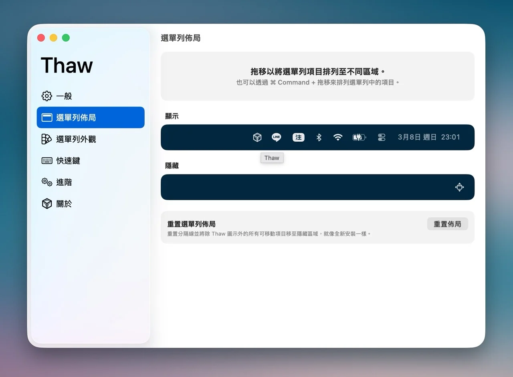
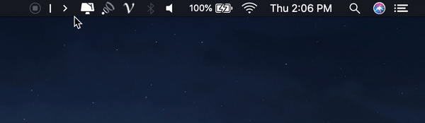
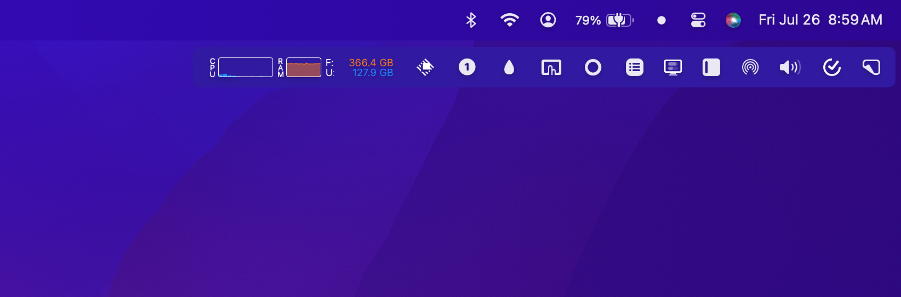

Mac顶部的菜单栏是个让人又爱又恨的位置，爱是因为极小的空间承载了小工具和常用入口的快速切换，但是烦人的是这里一直没有提供一个快捷隐藏收起功能，导致工具过多时候，内容密密麻麻排满整个工具栏，展示不下的工具，如果其他应用不关闭，可能一辈子在顶部都看不到。

于是有了三方方案：

- 花钱可以解决的：Bartender 5， 100+RMB
- 社区免费方案：**Ice、Thaw、Hidden Bar、Vanilla（没用过）、Dozer（没用过）**

Thaw：

Hidden Bar：

Ice：

使用过的几套方案，Ice是让人动心的，因为自定义菜单栏是脱离于原生工具栏，可以独立展示隐藏，并不会挤占原本并不富裕的顶部菜单栏。

Thaw作为Ice的继承者，实际使用体验和Hidden Bar基本一致，通过在顶部设置一个分隔符，然后左右拖动图标实现结果分隔符左边隐藏，右边展现。但有一个问题没解决：顶部如果有需要太多展示，但是空间不够展现不出来的的工具图标，无论如何拖拽都无法被看到，这就体现出自定义工具栏的优势。

使用了一段时间Ice，升级MacOS系统，启动点击直接奔溃。作者很少更新，使用社区的PR提交本地构建，构建问题层出不穷。让AI借鉴Ice，实现一个轻量粗糙版本，支持自定义工具栏隐藏图标、支持在自定义菜单栏拖拽组合，浅浅满足下自己需求，可以作为一个参考实现：https://github.com/onvno/wd-ice-bar

作为一款轻量工具，即便有源码参考的情况下，AI Agent在实现简版过程还是屡屡挫败。了解了一下隐藏Bar的功能实现，社区开发者为了实现隐藏Bar，在没有API的情况，各种组合，既有无奈，又有属于开发者的工匠精神。聊聊隐藏Bar的一些实现方式，以轻松的问答形式整理了下。

**简单介绍下隐藏图标的实现**

先说下“隐藏”，顶部Menu Bar中，所谓的隐藏不是真正的隐藏，是提供一个占位的透明条，将其他应用图标挤出屏幕外。看到的清爽空间，其实是另外一种“隐藏”。

**为什么不直接做一个真实的隐藏功能？**

苹果官方没有支持，所以只能在有限的API中寻找解决方案，当前这套方案应该是一个共识。

**简述一下整体方案？**

先了解两个概念，原生菜单栏 - 就是MacOS顶部原生菜单栏；自定义菜单栏 - 应用独立渲染的菜单栏（如Ice或者Bartender独立提供的菜单栏）

最简易实现：原生菜单栏中提供一个分割符图标，拖拽各应用图标到分割符左右两侧。启用后，分隔符左边的推出屏幕，右侧的保留在屏幕内。

完整版实现：配合自定义菜单栏

- 将原本顶部的第三方应用图标做一个图片缓存，做好与真实工具的映射关系
- 自定义工具栏中对各种应用图标进行操作后，会在原生菜单栏模拟进行操作

**为什么需要申请屏幕录制和辅助操作功能？**

MacOS 没有公开 API 可以直接调用任意第三方状态栏图标的菜单，所以我们看到的应用能力，都需要进行模拟操作。

- 屏幕录制权限是需要将顶部应用图标作为截图，转存在自定义工具栏，作为隐藏图标可以独立展示，方便后续操作。
- 辅助操作权限的申请，是提供协助操作，实现自动拖拽图标，点击应用图标等能力，如自定义菜单栏点击图标左键或右键，利用辅助操作权限，实现原生菜单栏中的同步点击。

**有什么比较hack的内容吗？**

隐藏菜单栏就是一次hack的冒险之旅，都是在官方不支持情况下，硬是模拟出一条路。

1. 当前的映射关系，在每一次调整顺序，或者新开应用后，都需要重新计算应用图标的坐标位置，状态等信息，重新进行映射和计算
2. 功能模拟的反复验证，需要各种模拟点击，尝试不同的组合效果验证，设定延时操作。
3. 依赖的WindowServer的一些API会存在系统更新，随时下线等问题。

本质上，还是应用系统不在意这个小功能，导致社区需要用各种hack方案解决。

官方并没有提供任何可靠API，现在我们能看到的这些隐藏Bar应用，各种交互体验，都是开发者一点一点去测试接口，探索可行性，然后一次次手动测试验证的结果，才能确保实现一整套闭环能力。当系统更新，又会出现各种适配问题，背后有太多的调试心血。为这些开发者和产品付费或者捐赠是值得的，感谢提供了这些好用的工具实践。

开源系统地址：

- Ice: https://github.com/jordanbaird/Ice
- Thaw: https://github.com/thaw-app/Thaw，官方仓库明确写明了，Thaw is an actively maintained fork of Ice, focused on fixes, compatibility, and new features.
- Hidden Bar: https://github.com/dwarvesf/hidden
- 自用仓库链接：https://github.com/onvno/wd-ice-bar